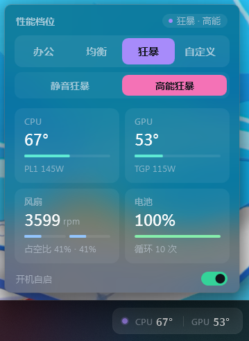

# mechrevo-widget

你是否也合盖立放笔记本，按不到性能调节按键，又觉得打开控制中心太卡？

机械革命（MECHREVO）笔记本的**轻量性能档位工具**：不用打开官方「机械革命控制中心」，在任务栏上就能看温度、切档位。

- **任务栏小组件** `MechrevoWidget.exe`：嵌在系统托盘左侧的小胶囊，实时显示 CPU / GPU 温度；点击弹出面板切换档位，查看风扇、功耗、电池。约 80 KB，无需安装运行时。
- **命令行脚本** `mechrevo_mode.py`：一行命令切档，适合配合脚本 / 快捷键使用。

两者都直接和官方后台服务通信，切档效果与在控制中心里点击完全一致，不需要重启服务。

<p align="center">
  
</p>

## 功能

**任务栏胶囊**

- 显示 CPU / GPU 实时温度，按温度变色（< 75° 白，75–87° 琥珀，≥ 88° 红）
- 左侧色点表示当前档位：办公 绿 · 均衡 蓝 · 狂暴 紫 · 自定义 白
- 鼠标悬停显示档位、功耗墙、风扇转速
- 右键菜单：快速切档、开机自启、重新贴到任务栏、打开日志、退出

**弹出面板**（点击胶囊）

- 档位切换：办公 / 均衡 / 狂暴 / 自定义，狂暴档可再选「静音狂暴 / 高能狂暴」
- 指标卡片：CPU 温度 + PL1/PL2、GPU 温度 + TGP、双风扇转速 + 占空比、电量 + 循环次数，每 2 秒刷新
- Windows 11 原生亚克力圆角背景
- 开机自启开关（通过任务计划程序以管理员权限启动，开机不弹 UAC）

## 系统要求

- 机械革命笔记本，且已安装官方「机械革命控制中心」（需要它的后台服务 GCUBridge，安装后默认开机自启）
- Windows 10 1903+ / Windows 11（自带 .NET Framework 4.8）。亚克力圆角背景需要 Windows 11 22H2+，更早的系统会退回普通模糊效果
- 读取温度 / 风扇需要管理员权限（程序启动时会请求）

> 本应用只在蛟龙16Pro 2025(8940HX+5060)上测试过。档位切换走的是官方服务协议，同代机型大概率通用；EC 寄存器（温度、风扇等读数）可能因机型而异，如果读数异常欢迎提 issue 并附上机型。

## 使用

### 任务栏小组件

1. 从 [Releases](../../releases) 下载 `MechrevoWidget.exe`（或按下文自行编译）
2. 双击运行，允许 UAC 提示
3. 胶囊会出现在任务栏托盘图标左侧；左键打开面板，右键打开菜单

更新时直接运行新版 exe 即可，新实例会自动关闭正在运行的旧实例。

### 命令行脚本

```bash
pip install paho-mqtt

python mechrevo_mode.py                 # 查询当前档位
python mechrevo_mode.py office          # 办公
python mechrevo_mode.py gaming          # 均衡
python mechrevo_mode.py turbo           # 狂暴
python mechrevo_mode.py custom          # 自定义（使用你在控制中心里保存的配置）
python mechrevo_mode.py turbo-silent    # 狂暴 · 静音
python mechrevo_mode.py turbo-extreme   # 狂暴 · 高能
```

脚本只切换档位、不读 EC，不需要管理员权限。

## 编译

需要 [.NET SDK](https://dotnet.microsoft.com/download) 6.0 或更高版本（编译产物面向 .NET Framework 4.8，运行时不依赖 SDK）。

```bash
cd MechrevoWidget
dotnet build -c Release
# 产物：bin/Release/net48/MechrevoWidget.exe
```

项目没有任何 NuGet 依赖，在 Linux / macOS 上也能编译（`EnableWindowsTargeting` 已开启）。

## 工作原理

```
官方控制中心 UI ──┐
mechrevo_mode.py ─┼─ MQTT ─▶ GCUBridge（本地 broker，127.0.0.1:13688）─▶ GCUService ─▶ EC：功耗墙 / 风扇曲线
MechrevoWidget ───┘

MechrevoWidget ── DeviceIoControl ─▶ \\.\ACPIDriver ─▶ EC：温度 / 风扇 / 电池（只读）
```

**切换档位**：官方控制中心的后台服务 GCUBridge 在本机 `127.0.0.1:13688` 上运行了一个 MQTT broker，UI 和执行服务通过它通信。本项目以官方托盘程序使用的客户端身份连接（只接受 MQTT 3.1.1），向 `Fan/Control` 发布命令：

| 操作 | Payload |
|---|---|
| 查询状态 | `{"Action":"GETSTATUS"}`（结果从 `Fan/Status` 返回） |
| 办公 | `{"Action":"OPERATING_OFFICE_MODE","ProfileIndex":"<n>"}` |
| 均衡 | `{"Action":"OPERATING_GAMING_MODE","ProfileIndex":"<n>"}` |
| 狂暴 | `{"Action":"OPERATING_TURBO_MODE","ProfileIndex":"<n>"}` |
| 自定义 | `{"Action":"OPERATING_CUSTOM_MODE","ProfileIndex":"<n>"}` |
| 狂暴 · 静音 | `{"Action":"SET_CPU_CORE_OFFSET_SILENT","SILENT":1}` |
| 狂暴 · 高能 | `{"Action":"SET_CPU_CORE_OFFSET_EXTREME","EXTREME":1}` |

`ProfileIndex` 读取自控制中心的 `UserPofiles\MainOption.json`，保证切到的是你在控制中心里选中的子配置。`Fan/Status` 中包含当前档位标称的 `CPU_PL1/PL2/PL4`、`GPU_ConfigurableTGPTarget` 等字段，面板上的功耗数字就来自这里。

**读取传感器**：官方驱动 UWACPIDriver 暴露了设备 `\\.\ACPIDriver`，用 `DeviceIoControl(0x9C40A488)` 可以读取 EC 寄存器（只读，本项目不写 EC）。已使用的寄存器：

| 地址 | 含义 | 说明 |
|---|---|---|
| `0x43E` | CPU 温度 | °C |
| `0x44F` | GPU 温度 | °C，独显休眠时为 0 |
| `0x464` / `0x465` | 风扇 1 转速 | 高字节 / 低字节，RPM |
| `0x46C` / `0x46B` | 风扇 2 转速 | 高字节 / 低字节（注意顺序与风扇 1 相反） |
| `0x75B` / `0x75C` | 风扇 1 / 2 PWM 占空比 | 0–255 |
| `0x4AB` | 电池电量 | % |
| `0x4A6` / `0x4A7` | 电池循环次数 | 16 位，小端 |

**嵌入任务栏**：把窗口改成 `WS_CHILD` 后 `SetParent` 到 `Shell_TrayWnd`，再定位到 `TrayNotifyWnd` 左侧。每 5 秒检查一次，资源管理器重启或托盘图标变化后会自动重新贴回去。

## 已知限制

- 依赖官方控制中心的后台服务；卸载控制中心或服务未运行时，组件只显示温度，无法切档
- 未经测试的机型上，EC 读数可能不正确或为空
- 胶囊嵌入任务栏用的是非官方方式，Windows 大版本更新后可能失效

## 免责声明

本项目是个人开发的第三方工具，与机械革命官方无关，也未获得官方认可。「机械革命」「MECHREVO」是其各自权利人的商标。

本项目只调用官方软件已经提供的本地接口来切换官方预设档位，读取硬件信息时不向 EC 写入任何数据。但修改性能档位本身会影响功耗和散热，请自行判断风险，**使用本软件造成的任何后果由使用者自行承担**。

## 许可证

[MIT](LICENSE)
